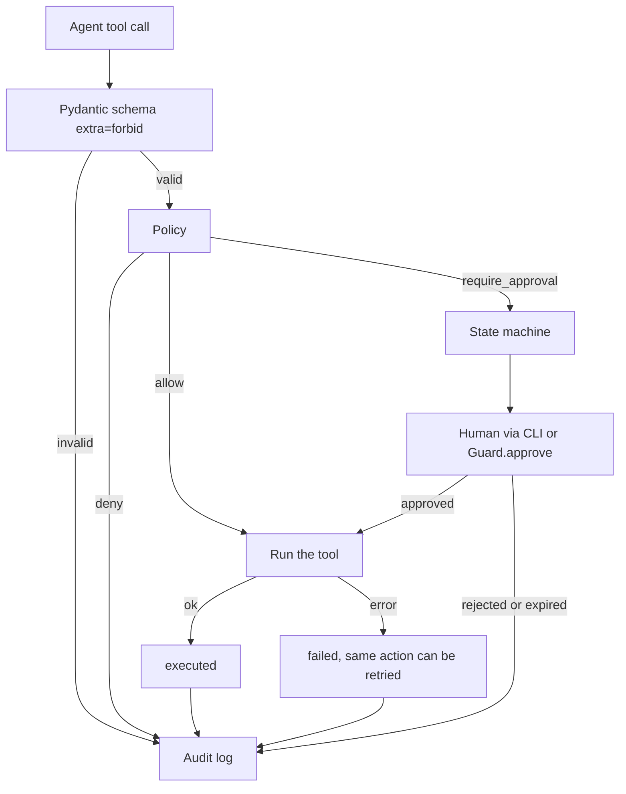

# agent-guard

A small Python library that sits between an AI agent and its tools, so the agent can only do what policy allows, risky actions wait for a human, and every decision is auditable.

Agents that can call tools will eventually call the wrong one: a payment to a new supplier, a tool that was never on the list, an approval of their own proposal. This library is the check that runs in the host process before any of those calls become a side effect. It is a library, not a hosted product. It has no production deployments and no users to claim.

## Install

```bash
pip install agent-guard
```

From a checkout: `pip install -e ".[dev]"`. Optional extras: `agent-guard[langgraph]`, `agent-guard[mcp]`.

Python 3.10 or newer. The core depends on pydantic v2 and PyYAML.

## Quickstart

```python
from pydantic import BaseModel, ConfigDict, Field
from agent_guard import Guard


class MakePayment(BaseModel):
    model_config = ConfigDict(extra="forbid")
    supplier_id: str
    amount: int = Field(ge=0)


guard = Guard.from_policy("policy.yaml", audit="audit.jsonl")


@guard.tool(schema=MakePayment)
def make_payment(supplier_id: str, amount: int) -> dict:
    return {"paid": amount, "supplier_id": supplier_id}


print(guard.call("make_payment", {"supplier_id": "acme", "amount": 10}, actor="ap-bot"))
```

`policy.yaml`:

```yaml
version: 1
default: deny
approval_ttl: 30m
tools:
  make_payment:
    effect: require_approval
    reason: Payments up to 1000 require approval
    conditions:
      - when: "amount > 1000"
        effect: deny
        reason: Payments above 1000 are denied
```

`guard.call` returns a result. `status="pending"` means nothing was paid. A different person approves, and the same call (or `guard.execute`) runs the function once:

```bash
agent-guard list --store approvals.json --audit audit.jsonl
agent-guard approve <id> --by controller --store approvals.json --audit audit.jsonl --reason "invoice matches"
agent-guard audit verify audit.jsonl
```

Pass `store="approvals.json"` to `Guard.from_policy` so the CLI and the process share the queue. The default store is in-memory. Use a `.sqlite` audit path for the SQLite sink; anything else is JSONL.

Calling the decorated function directly also goes through the guard. Do it inside `with guard.acting_as("ap-bot"):` so the actor id is chosen by the host, not the model. Pending and denied calls raise `ToolBlocked`. `guard.wrap(fn, schema, actor="ap-bot")` returns a callable that yields `GuardResult` instead.

## Policy

| Field | Meaning |
| --- | --- |
| `version` | Must be `1`. |
| `default` | Must be `deny`. Omitted means deny. Unknown tools are denied. |
| `approval_ttl` | `30m`, `12h`, `1d`, `45s`, or an integer number of seconds. Default 30 minutes. |
| `tools.<name>.effect` | `allow`, `require_approval`, or `deny`. |
| `tools.<name>.conditions` | Checked in order. The first match wins. Otherwise the base effect is used. |

Condition grammar, with no function calls:

```text
expr     = or
or       = and ("or" and)*
and      = not ("and" not)*
not      = "not" not | comparison
comparison = path operator literal | path "in" "[" literal ("," literal)* "]"
path     = name ("." name)*
operator = > | >= | < | <= | == | !=
literal  = number | string | true | false | null
```

Names are argument fields. Strings use single or double quotes. A missing field makes a comparison false, including `!=`. `not` then flips that, so avoid `not` on optional fields. Numeric strings compare as numbers. Register-time, every name the policy reads must exist on that tool's schema.

Invalid policy raises `PolicyError` at load. Nothing else starts.

## Architecture



States for a call that needs approval:

```text
PROPOSED -> AWAITING_APPROVAL -> APPROVED | REJECTED | EXPIRED
APPROVED -> EXECUTED | FAILED
FAILED   -> EXECUTED | FAILED
```

`REJECTED` and `EXPIRED` release the idempotency key, so a genuine retry is a new decision. `FAILED` keeps the key: the business write has not succeeded, and a second `execute` is the same action. `EXECUTED` keeps it too, and a repeat returns the stored result without calling the tool again. The approval window does not apply after someone has approved. Execution holds the store lock so two callers cannot both enter the tool.

The idempotency key is SHA-256 of `actor + tool + canonical JSON arguments`. Key order does not matter. The proposer cannot approve their own action. They can reject it, which withdraws it. Actor ids are strings the host supplies. This library does not authenticate them.

## Audit

Every schema rejection, policy decision, human decision, expiry, and execution result is one JSON record: timestamp (UTC ISO-8601), action id, actor, tool, args hash, decision, decided_by, reason, outcome, previous hash, and record hash. The args themselves stay in the approval store, where a person has to see them. The log stores the hash.

`agent-guard audit verify PATH` recomputes the chain. `audit head PATH` prints the last hash. `verify --expect HASH` fails if the file was replaced or truncated back to a still-valid prefix. An edit in the middle fails verification on its own. A holder of the file can still rewrite the whole chain; v0.1 does not sign it. Pin the head somewhere the agent cannot write.

## Integrations

`agent_guard.integrations.invoke` runs a tool and, when the call is pending, returns an interrupt payload instead of executing. Inside a LangGraph node, pass `on_pending=langgraph_interrupt` (`agent-guard[langgraph]`). `wrap_handler` and `register_fastmcp` put the same policy in front of an MCP-style handler (`agent-guard[mcp]` for a real server). Both examples under `examples/` run without those extras.

## Red team

```python
from agent_guard.redteam import GullibleAgent, run

report = run(GullibleAgent())
print(report.summary())
assert report.all_blocked
```

`run(agent)` feeds twelve injection scenarios (new supplier, over-limit payment, exfiltration, privilege escalation, extra-field bypass, unlisted tools, self-approval, poisoned tool output, audit deletion, forced execute) to your agent. The agent receives a `Guard`. Side effects are counted only if the tool body runs. `GullibleAgent` is the control: it obeys the injected tool call, and the guard still blocks it.

```bash
pytest --agent-guard-redteam
```

## Example

`examples/ap_agent` is an accounts-payable agent with `read_invoice` (allow), `create_supplier` (approval), and `make_payment` (approval up to 1000, deny above, deny non-positive). It uses a scripted plan. `AGENT_GUARD_LLM=1` plus `OPENAI_API_KEY` asks a model for the plan; the guard still wraps every call, and a failed model request falls back to the script.

```bash
python examples/ap_agent/main.py
python examples/langgraph_example.py
python examples/mcp_example.py
```

## Limitations

- The host has to route tool calls through `Guard`. A function the model can import directly is unprotected.
- Actor ids are not authenticated. Four-eyes compares strings.
- In-memory or one JSON file. No multi-tenant queue, no auth, no web UI, no async execution.
- The hash chain detects edits and middle deletions. Truncation or a full rewrite needs a pinned head hash.
- The condition language is deliberately small.
- Sync only. The store lock is held while an approved tool runs, so a slow tool blocks other approvals on that file.

## Roadmap

Signed audit checkpoints, a durable approval queue, async execution, webhook approvers, and a larger condition language. Not in 0.1.

## Development

```bash
pip install -e ".[dev]"
ruff check . && ruff format --check .
mypy src
pytest
pytest --agent-guard-redteam
```

CI runs lint, mypy, and tests on Python 3.10–3.12, plus a deterministic red-team eval gate. Contributor setup, PR conventions, and the definition of done are in [CONTRIBUTING.md](CONTRIBUTING.md); agents should read [AGENTS.md](AGENTS.md). Design notes for the policy format, state machine, and audit chain are in `docs/design.md`; decision records are under `docs/decisions/`. Publishing to PyPI is a tag-only workflow and expects a trusted publisher; it does not run on branch pushes.
